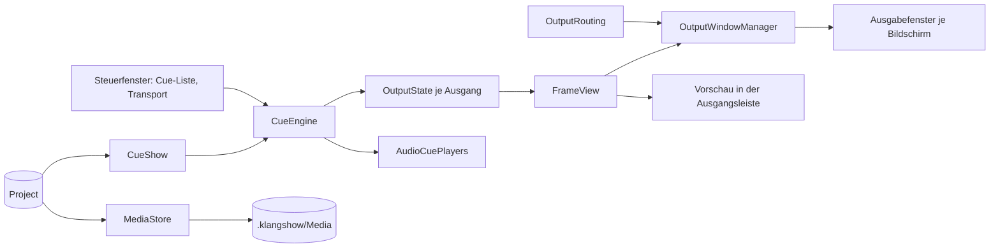
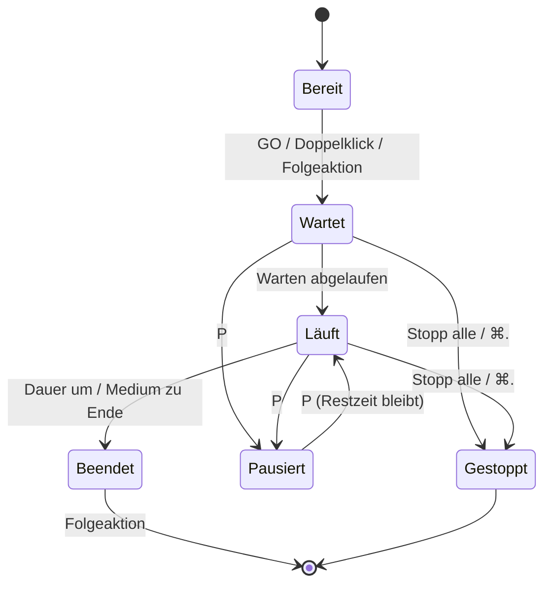

# Architektur

CueView ist ein Cue-Player (ab v2.0): eine nummerierte Cue-Liste, eine Cue-Engine, mehrere Ausgänge. Konzept und Entscheidungen: `docs/KONZEPT-CUEPLAYER.md`.

## Module
- **App/** – Einstieg, Dokument-Szene (`DocumentGroup`), Fenster (Steuer, Willkommen, Hilfe, Über). `AppDelegate` hält die app-weiten Dienste (eine `CueEngine` für alle offenen Projekte).
- **Core/Model/** – Datenmodell (`Project`, `Medium`, `Cue`, `CueGroup`, `OutputDefinition`, `Layer`), Bearbeiten der Liste (`CueListEditing`, `CueTrim`, `OutputEditing`), `TimeFormat` (`m:ss.cc`), `OutputState`.
- **Core/Storage/** – `.klangshow`-Paket (FileWrapper), `MediaStore` (einziger Medienzugriff), `ProjectCodec` (Schema-Version, Migration v1 → v2 über `ProjectFormat1`), Zip-Export/Import.
- **Playback/** – `CueEngine` (Zustandsautomat, Zeit über `StepScheduler` und `now` injizierbar), `CueShow` (Liste aufbereitet für die Engine), `AudioCuePlayer(s)`, `ShowSimulation` (Zeitstrahl, fährt die echte Engine mit `VirtualClock`), `SessionRestore`.
- **Rendering/** – `FrameView`/`MediaView`/`VideoSurface`: EIN Renderer für Ausgänge, Vorschau und Editor.
- **Features/** – `CueList`, `Inspector`, `Trim`, `Timeline`, `Transport` (Leiste + Menü „Wiedergabe“), `Outputs` (Ausgangsleiste, Zuordnung), `Output` (Ausgabefenster je Ausgang), `Control` (Steuerfenster, Black-Schaltflächen), `Library`, `LayerEditor`, `Help`, `Info`, `Welcome`, `Archive`.
- **UI/** – `Theme` (Farb-Tokens), `ReorderableList`, `DurationField`, `PanelHeader`, gemeinsame Komponenten.
- **System/** – `DisplayService` (Hotplug), `OutputRouting` (Ausgang ↔ Bildschirm je Rechner), `HotkeyService` (Ein-Tasten-Kürzel), `SessionStore`, `SleepGuard`.



## Datenmodell (Schema-Version 2)
- **Project** – `schemaVersion`, `media: [Medium]`, `cues: [Cue]` (geordnet), `groups: [CueGroup]`, `outputs: [OutputDefinition]`.
- **Medium** – `id`, `kind` (image | video | audio), `fileName` (eindeutig, in `Media/`), `displayName`.
- **Cue** – `id`, `number` (Text, z. B. „1.5“), `name`, `mediumID?`, `outputID?` (Audio: keiner), `wait`, `inPoint`/`outPoint?` (Trim), `stillDuration` (Bilder), `followAction` (Halten | Weiter nach Ende | Mit nächstem starten), Lautstärke, Fades, Blende ein/aus, Skalierung, `layers`, Notiz, Farbe.
- **CueGroup** – `firstCueID`…`lastCueID` (zusammenhängender Bereich der Liste), Modus Loop ∞ | n-mal, Überblendung, zugeklappt.
- **OutputDefinition** – logischer Ausgang (`id`, Name). Welcher Bildschirm ihn zeigt, steht nicht im Projekt, sondern je Rechner in `OutputRouting`.
- **Layer** – `position`, `width` (relativ), `content: text(TextStyle) | image(mediumID)`, Animationen; gerendert von `FrameView` identisch für Ausgang und Vorschau.
- **OutputState** – je Ausgang `content` (`idle` | `blank` | `cue(CueFrame)`) plus Black (alle oder je Ausgang). Black liegt über dem Inhalt, Cues laufen darunter weiter.
- **v1-Altformat** – `ProjectFormat1` (`V1Group`/`V1Entry`) dient nur noch der Migration in `ProjectCodec`; beim Speichern bleibt `project.v1.json` als Sicherung im Paket.

## Zustandsautomat

### Cue (in `CueEngine.running`)

- **Beendet** löst die Folgeaktion aus: *Halten* (Bild bleibt stehen, Video geht auf Schwarz), *Weiter nach Ende* (nächster Cue startet), *Mit nächstem starten* (der nächste Cue startet bereits zusammen mit diesem).
- **Gruppe:** innerhalb gilt „Weiter nach Ende“; nach dem letzten Cue beginnt der Durchlauf von vorn (Loop ∞) bzw. endet nach n Durchläufen mit „Halten“.
- **Abspielkopf:** GO startet den Cue am Kopf und setzt ihn hinter die mitgestartete Kette; Klick und ↑/↓ setzen ihn ohne Start. „Stopp alle“ lässt ihn stehen.
- Fehlt ein Medium, wird der Cue übersprungen und in der Transportleiste gemeldet.

### Ausgang
Unabhängig von den Cues: Ein Ausgang zeigt den zuletzt erschienenen Cue seines Ausgangs (`idle` → `cue` → `blank` bei Video-Ende mit „Halten“). Black (B = alle, ⇧B/Schaltfläche = je Ausgang) überdeckt den Inhalt sofort; Aufheben zeigt ihn unverändert weiter.

### Bedienung
- Tasten über `HotkeyService` (greifen nicht in Textfeldern): Leertaste GO, P Pause/Fortsetzen, B Black alle, ⇧B Black des Ausgangs am Abspielkopf, Esc stoppt nur, wenn ein Ausgang den Steuerbildschirm blockiert. ⌘. (Notfall-Stopp: Stopp + Audio hart aus) liegt im Menü „Wiedergabe“ und wirkt immer.
- **Messe-Modus** (`@AppStorage` „isTradeShowMode“, ⇧⌘M): Liste gesperrt (`ReorderableList.isEditable`), Medienbereich, Inspektor, Zeitstrahl und Pause ausgeblendet; GO, Stopp, Black bleiben.

## Paketformat `.klangshow`
Document Package (Ordner, im Finder eine Datei; UTType exportiert):
```
Projekt.klangshow/
  project.json     # schemaVersion, Modell
  Media/           # alle verwendeten Dateien (beim Hinzufügen kopiert)
```
Medien werden beim Hinzufügen lazy referenziert und erst beim Speichern ins Paket geschrieben (`MediaStore`); nicht mehr verwendete Dateien fallen beim Speichern weg.
Export (`ProjectArchive`): `.zip` des gespeicherten Pakets über `NSFileCoordinator(.forUploading)` – offene Änderungen werden vorher gespeichert. Import entpackt mit `ditto` neben die Zip-Datei, prüft Aufbau und `schemaVersion`, vergibt bei Namensgleichheit „Name 2“ und öffnet das Projekt.

## Ordnerstruktur
```
MessePlayer/
  App/  Core/{Model,Storage}/  Playback/  Rendering/
  Features/{CueList,Inspector,Trim,Timeline,Transport,Outputs,Output,Control,Library,LayerEditor,Help,Info,Welcome,Archive}/
  UI/  System/  Resources/{Assets.xcassets,Help,Sample}/
MessePlayerTests/
docs/  Branding/
```
