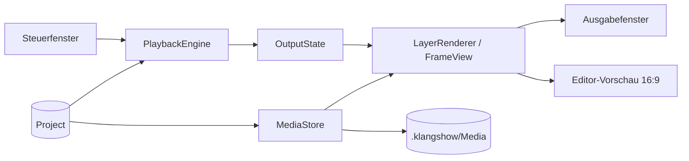
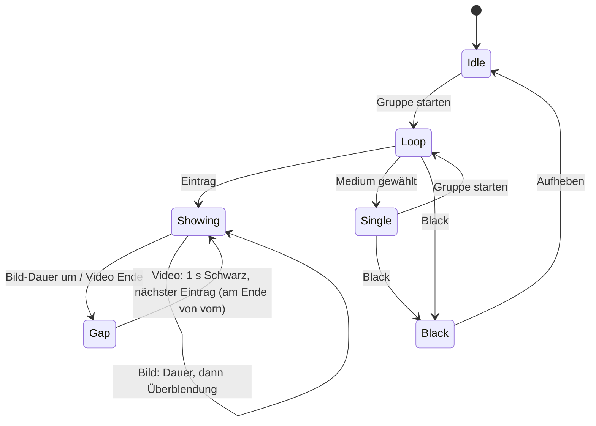

# Architektur

## Module
- **App/** – Einstieg, Dokument-Szene (`DocumentGroup`), Fenster (Steuer, Ausgabe).
- **Core/Model/** – Datenmodell (`Project`, `Medium`, `Group`, `Entry`, `Layer`), `Codable`, Schema-Version.
- **Core/Storage/** – `.klangshow`-Paket (FileWrapper), `MediaStore` (einziger Medienzugriff), Zip-Export/Import.
- **Playback/** – `PlaybackEngine` (Zustandsautomat, Uhr injizierbar), Vorladen, Überblendung.
- **Rendering/** – EIN `LayerRenderer`/`FrameView` für Ausgabe und Vorschau.
- **Features/Library, Groups, LayerEditor, Output, Control** – Views + ViewModels je Feature.
- **UI/** – `Theme` (Farb-Tokens), `ReorderableList`, gemeinsame Komponenten.
- **System/** – Bildschirmverwaltung (Hotplug), `IOPMAssertion`, Tastenkürzel, Zustandswiederherstellung.



## Datenmodell
- **Project** – `schemaVersion`, `media: [Medium]`, `groups: [Group]`, Einstellungen (Überblendung s, Ausgabe-Bildschirm).
- **Medium** – `id`, `type` (image|video), `fileName` (relativ in `Media/`), `duration?`.
- **Group** – `id`, `name`, `entries: [Entry]` (geordnet).
- **Entry** – `id`, `mediumID`, `imageDuration` (nur Bilder, s), `layers: [Layer]`.
- **Layer** – `id`, `frame` (x, y, relativ 0–1), `content: text(TextStyle) | image(mediumID)`. TextStyle: Text, Schrift, Größe, Farbe, Ausrichtung, Schatten, Box.
- **OutputState** – `content: OutputContent` (`idle` | `single` | `loop(groupID, index)`) plus `isBlack`. Black liegt über dem Inhalt, Aufheben zeigt ihn unverändert weiter.

## Abspiel-Zustandsautomat

Nächster Eintrag wird während des aktuellen vorgeladen. Black wirkt sofort und überschreibt alles; Aufheben stellt den vorherigen Zustand wieder her.

## Paketformat `.klangshow`
Document Package (Ordner, im Finder eine Datei; UTType exportiert):
```
Projekt.klangshow/
  project.json     # schemaVersion, Modell
  Media/           # alle verwendeten Dateien (beim Hinzufügen kopiert)
```
Export: `.zip` des Pakets; Import entpackt und validiert `schemaVersion` (Migration bei älterer Version).

## Ordnerstruktur
```
MessePlayer/
  App/  Core/{Model,Storage}/  Playback/  Rendering/
  Features/{Library,Groups,LayerEditor,Output,Control}/
  UI/  System/  Resources/{Assets.xcassets,Branding}/
MessePlayerTests/
docs/  Branding/
```
